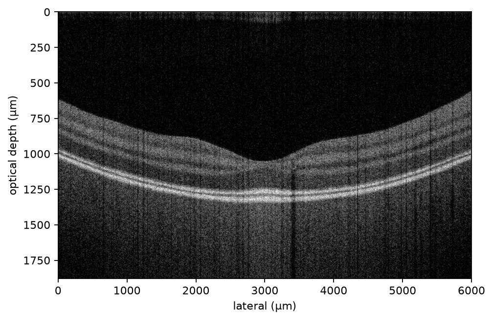
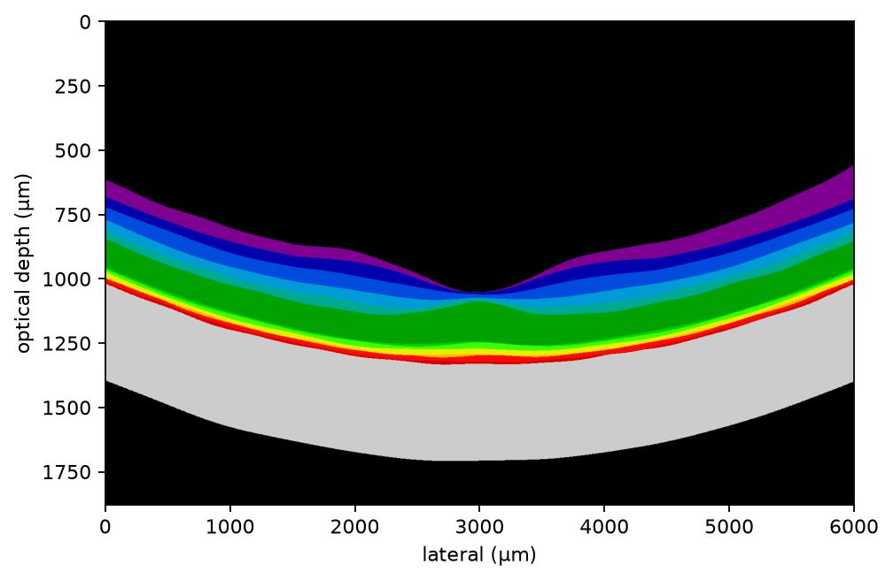
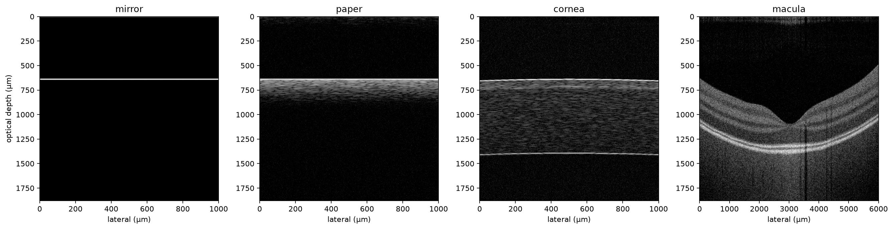

# OCT Simulator

[](LICENSE)
[](pyproject.toml)

A physics-based optical coherence tomography (OCT) simulator for training deep
models when real labeled data is scarce. Every sample is generated from a
forward optical model, per spectrum, per A-scan — not a texture filter over a
label map — and comes with a free, pixel-perfect layer/feature ground truth.

There is a **programmatic API** and a **PySide6 GUI**.

<table>
  <tr>
    <td align="center"></td>
    <td align="center"></td>
  </tr>
  <tr>
    <td align="center"><strong>Simulated macular B-scan</strong></td>
    <td align="center"><strong>Free per-pixel layer labels</strong></td>
  </tr>
</table>

The label map above is a byproduct of rendering, not a separate annotation
step — every generated sample ships one.

<p align="center"></p>

## Quickstart

```python
from octsim import SimConfig, simulate, generate_dataset

cfg = SimConfig(
    anatomy="macula", scan_pattern="volume", n_frames=32, slow_fov_um=6000.0,
    lateral_fov_um=6000.0, lines_per_frame=512,
    line_rate_hz=100_000, motion_level=1.0, noise_level=1.0,
)
sample = simulate(cfg, seed=1)                 # one B-scan or volume
sample.volume_db          # [n_frames, depth, x] display stack (dB)
sample.label_map          # [n_frames, depth, x] layer index (free ground truth)

for s in generate_dataset(cfg, n=200, seed=0): # N random samples, in-memory
    train_on(s.bscan_db, s.labels2d)
```

```bash
octsim                       # launch the GUI (needs the [gui] extra)
octsim --generate 5 --anatomy macula --pattern volume --frames 16   # headless
octsim --selftest            # headless smoke test, exit 0/1
```

## The physical model

Per A-scan: a scene → a complex reflectivity field → the interferometric
spectrum `I(k) = P(k)·|a_ref + Σ r·exp(i·2k·z)|²` → DC-removal + window + IFFT
→ B-scan. On top of the ideal fringe, the forward model folds in the
instrument and acquisition physics that make a simulated scan behave like a
real one rather than a clean rendering:

- **Source & resolution** — Gaussian source sampled linearly in `k`;
  wavelength and bandwidth set the axial resolution.
- **Sensitivity fall-off & dispersion** — depth-dependent roll-off and a
  single dispersion knob (magnitude = axial stretch, sign = chirp direction).
- **Acquisition speed** — line/sweep rate sets the integration time, which
  drives both the collected signal (shot-limited SNR) *and* fringe washout —
  the real OCT speed/SNR trade-off, emergent rather than hand-tuned.
- **Motion & artifacts** — one continuous depth trajectory (drift, cardiac,
  microsaccades) sampled along acquisition time, so bulk motion and washout
  are correlated across A-scans and across the frames of a volume.
- **Detector noise** — shot, RIN, and read noise, tunable clean → degraded.
- **Wavelength-dependent tissue optics** — scattering and absorption vary
  with wavelength, so 1050/1310 nm penetrate the choroid better than
  830–880 nm, matching known device behavior.

Single-scattering only: every scatterer contributes once to a given A-scan.

## Anatomy

Retina is modelled in 3D with physiological layer thicknesses and the
characteristic OCT layer pattern, so a volume sweeps a consistent scene:
a foveal pit with inner layers thinning toward the centre, an optic-nerve-head
model with Bruch's-membrane termination and a central cup, and blood vessels
with the correct hyporeflective-lumen/shadow signature. `generate_dataset`
draws a fresh random anatomy, speckle, and motion realization per sample,
reproducibly.

## Realism validation

Simulated and real scans are scored with the same metric code — geometry,
layer contrast, choroid texture, noise floor — against a training corpus and
several **held-out devices the model was never fit to**, so improving the
training score while quietly overfitting is visible immediately:

```bash
python scripts/validate_realism.py --folder "path/to/training_device_corpus" \
    --holdout held_out_device --holdout octa500 --holdout octid
```

Held-out corpora are metric-*tiered*: 8-bit display-domain data has passed through an
unknown tone curve, so only the statistics that survive it (geometry, spatial
correlations) are scored there. Point `$OCT_DATA_ROOT` at a local scan tree; raw data is
never committed.

## Package map

```
octsim/
  config.py        SimConfig (resolvable) + resolve() -> ResolvedConfig
  source.py        Gaussian source / k-grid / axial calibration
  optics.py        sensitivity fall-off + beam helpers
  dispersion.py    dispersion phase + compensation
  acquisition.py   scan geometry + timing (speed -> integration time)
  motion.py        continuous depth trajectory; bulk motion / drift / washout
  sample.py        reflectivity core (speckle, per-column attenuation, features)
  anatomy/retina.py  layered retina model (foveal pit, ONH, vessels)
  forward.py       interferometric spectrum with fall-off + dispersion + motion
  reconstruct.py   IFFT reconstruction (+ optional dispersion compensation)
  noise.py         shot / RIN / read detector noise
  generate.py      simulate() (B-scan/volume) + generate_dataset() (N samples)
  realism_metrics.py  sim-vs-real metric vector + validation gates
  presets.py       mirror / paper / cornea / macula
  gui/             PySide6 app + CLI
```

## Install & test

```bash
git clone https://github.com/tangericm/OCT-Simulator.git
cd OCT-Simulator
pip install -e .            # core (numpy, scipy)
pip install -e .[gui]       # + PySide6, pyqtgraph, matplotlib for the GUI

python -m pytest
QT_QPA_PLATFORM=offscreen python tests/test_gui_smoke.py
```

The physics, anatomy, and generation suites are data-free, so the full test
suite runs in CI without any real scans; anything that needs real data or
PySide6 skips cleanly.

This is research software and is not intended for clinical diagnosis or
treatment.

## Roadmap

- Calibrate retinal layer optical properties against real macular OCT
  (biggest remaining realism lever).
- Cornea anatomy (endothelial mosaic, iris, lens) on the same feature
  framework.
- Raw-data writers to feed the OCT-Denoiser and reconstruction pipelines.
- Optional GPU/torch forward path for very large corpora.

## License

Released under the [MIT License](LICENSE).
